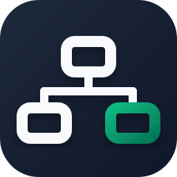
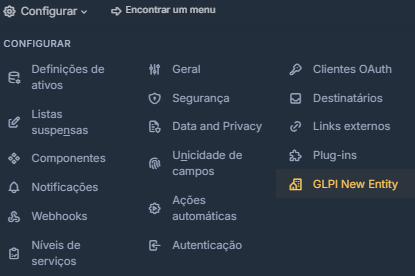
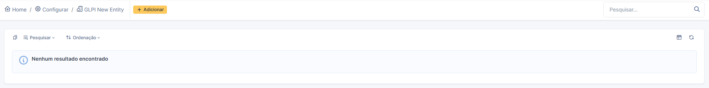
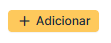
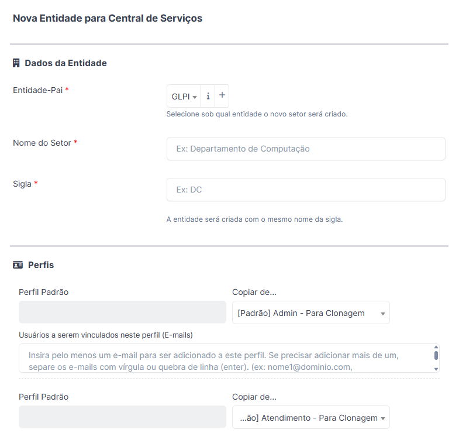
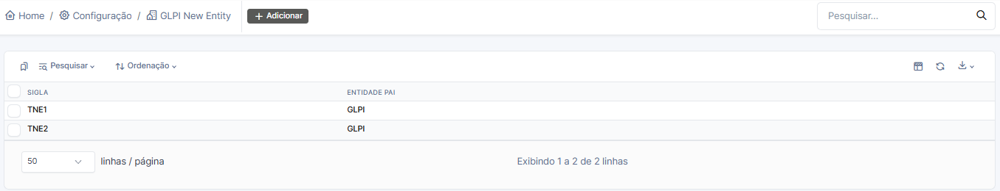
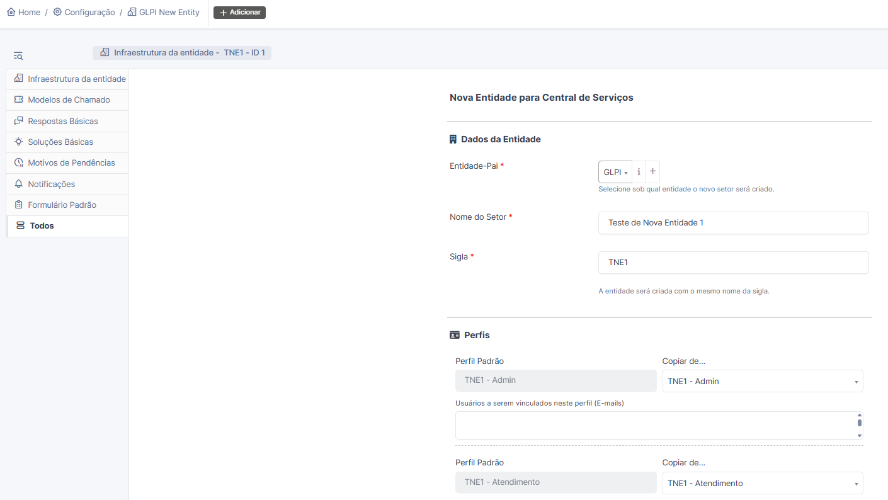

<div align="right">
  🇧🇷 <a href="../../README.md">Português</a> | 🇬🇧 <a href="./README.en.md">English</a> 
</div>

# GLPI New Entity Plugin - Complete structure creation in a single screen
[](https://glpi-project.org/)
[](https://glpi-project.org/)
[](https://www.gnu.org/licenses/gpl-3.0.html)

<p align="center">
  <br><br>
</p>

The **GLPI New Entity Plugin** is a fast and optimized onboarding plugin developed for GLPI 11/12. Its purpose is to automate the structural setup of a new Sector / Department into a single unified form (a "Wizard"). 

Instead of navigating through several GLPI screens to create entities, configure profiles, link users, create groups, associate technicians, and build service catalogs (ITIL categories), this plugin performs the entire process from a single screen. This guarantees extreme agility, standardized structures, and minimizes human errors.

## ✨ Main Features

*   **Fast Entity Creation:** Instantly creates a new entity under a chosen parent entity.
*   **Native Profile Cloning:** Allows you to select supported pre-existing profiles (such as Admin or Technician) and clone them, automatically naming them using the new sector's acronym prefix (e.g., `[DC] - Admin`). Super-Admin profiles are intentionally excluded for security reasons.
*   **Direct E-mail Linking:** Just paste a list of e-mails, separated by commas or line breaks. The plugin searches for the user in the database and automatically links the profile to the new entity with recursive scope.
    *   Optionally, enable the default-profile switch on one or more profiles. For each user, a selected Admin profile takes priority; otherwise the most recent assignment among the selected profiles wins. The entity is also set as the default. With no selection, existing preferences remain unchanged for retained assignments.
*   **Smart Group and Subgroup Management:**
    *   Automatically creates a "Parent Group" named with the sector's acronym `(ACRONYM)`.
    *   Allows the dynamic creation of multiple nested Subgroups.
    *   Associates support technicians to their respective subgroups (or directly to the Parent Group) from an e-mail list.
*   **Automatic ITIL Category Tree Construction:**
    *   Accepts hierarchical lists in text format using hyphens (e.g., `- Hardware`, `-- Maintenance`, `--- Repairs`).
    *   Creates perfectly nested incident and request categories with a single click.
*   **Configuration Tabs Visible During Creation:** The tabs appear on the creation form so you can see the available settings. Create the entity structure in the main tab before opening the other tabs and saving their settings.
*   **Dynamic Configuration:** After creating the structure, customize the sector's workflows and templates in the tabs:
    *   **Ticket Templates**
    *   **Standard Follow-ups**
    *   **Standard Solutions**
    *   **Pending Reasons**
    *   **Notification Templates:** Immediately above Notifications, with native template copying, type, all GLPI languages, subject and the HTML editor with source-code viewing. Other translations and source CSS are preserved. The read-only Notification field shows saved associations from Notifications > Notification Template. Templates are global in GLPI: editing a saved template affects every notification using it; copying creates a separate template without changing its source.
    *   **Notifications**
    *   **Standard Forms**
*   **Native Security and Access Control:** Developed following GLPI's strictest secure development standards. The interface and all creation flows (endpoints) are protected by the system's dynamic rights matrix (ACL). The installation intelligently grants access to all Super-Admin profiles natively and agnostically, without depending on hardcoded IDs and avoiding visual pollution for other users.
*   **Synchronized Editing and Updating:** In case of future adjustments, the system stores metadata and allows you to re-edit groups, e-mail links, or sector names from a central record.
*   **Form Protection:** Retains a wizard draft after errors and warns before leaving forms with unsaved changes.
*   **Selectors and Template Copying:** ITIL categories, follow-up templates, and solution templates are grouped by entity; a loading indicator is displayed while copying.

## 🛠️ Requirements

*   **GLPI:** Version 11.0.0 or higher.
*   **PHP:** Versions supported by GLPI 11 or higher (8.1, 8.2, 8.3, 8.4).

## 🚀 Installation

1. Download the repository files or clone this project into your GLPI server's plugins directory:
   ```bash
   cd /var/www/html/glpi/plugins/
   git clone https://github.com/andrefelipeufcg/glpinewentity.git
   ```
2. Ensure the folder is strictly named `glpinewentity`. Fix the nomenclature if git downloads it with a different suffix.
3. Access the GLPI web interface using your **Super-Admin** user.
4. Navigate to **Setup > Plugins**.
5. In the list, locate `GLPI New Entity`, click the **Install** button (folder icon) and then the **Enable** button (power icon).

## 🖥️ How to Use

1. Log into GLPI using a user with the **Super-Admin** profile.
2. In the main top menu, navigate to **Setup > GLPI New Entity**.

3. You will see a list (empty if it's your first time) of the sector infrastructures managed by the plugin.

4. Click **Add** (or the "+" button depending on your theme).

5. Follow the Wizard instructions. The configuration tabs are also visible when adding a sector, but can only be opened after the entity is saved:

   *   **Parent Entity and Acronym:** Indicate the location in the corporate tree and the acronym (which will name the entity and groups).
   *   **Profiles:** When creating a profile, select its source and the e-mails of the sector managers to inherit this access recursively. When editing, the source selector is shown only for new profiles.
       Standard profiles (Admin and Atendimento) and additional profiles have a **Remove** button with the same trash icon as the groups. Removal only changes the form until it is saved. During creation, removed profiles are not created; during editing, saving and confirming permanently deletes the existing GLPI profile and its user assignments across all entities, even when users are assigned. At least one profile must remain.
   *   **Subgroups and Technicians:** Add as many subgroups as needed, and paste all the e-mails of the responsible technicians.
   *   **Catalog (Categories):** Paste or write your category tree using "-" for sublevels.
6. Click **Save**.

If creating or updating the structure fails, the Wizard keeps the submitted data in the session so you can correct it and retry, including profiles, users, groups, and categories. During creation, data is restored only when returning after an error; opening a new creation form starts fresh. If the entity was partially created, the form continues in edit mode for that entity. Editing drafts are cleared after a successful save.



7. **Advanced Adjustments and Configurations:** The tabs are visible during creation. Once the structure is created, open them on the form or return to the list and click the sector name to edit it. The tabs let you customize the entity's operation:



   *   **Entity Infrastructure:** Returns to the Wizard form to edit members, groups, and categories.
   *   **Ticket Templates:** Create and associate specific ticket templates.
   *   **Standard Follow-ups:** Configure standardized texts for support replies.
   *   **Standard Solutions:** Standardize frequent solutions for ticket closure. The selected solution type is created in the sector's entity even if it belongs to another entity; an existing type with the same name in that entity is reused.
   *   **Pending Reasons:** Define customized reasons for pausing tickets.
   *   **Notification Templates:** Copy or edit templates and translations used by notifications. These templates are global in GLPI.
   *   **Notifications:** Adjust or override sector e-mail alerts.
   *   **Standard Forms:** Manage forms (from Formcreator) linked to the sector.

In each configuration tab, click **Save** to save and apply changes to the entity.

## Ticket Transfer Plugin Integration

The integration is disabled by default. In **Setup > Plugins**, open the GLPI New Entity configuration, enable the integration, and enter the exact folder name of the transfer plugin installed under `plugins` or `marketplace` (for example, `transferticketentity`). The name is case-sensitive, limited to 50 letters or digits, and must identify an existing plugin folder containing `setup.php`. The plugin must also be active and provide the expected classes, namespace, and table conventions; not every transfer plugin is compatible. The configuration page links to **Setup > GLPI New Entity**, where sectors are listed and created.

When the integration is active and compatible, the wizard shows options for entity transfers, profile permissions, and inclusion of subgroup members in the default assigned group. The options default to enabled for new items and reflect saved settings when editing. Selections are retained in the wizard draft after errors. When the integration or transfer plugin is inactive, the controls are hidden and transfer settings are not changed.

Saving applies the current settings from the transfer plugin's Entities and Profiles tabs while preserving unrelated selections. Group synchronization uses the current transfer plugin's selected source groups and default assigned group. Changes to members of selected source groups also trigger synchronization. The assigned group's membership is made equal to the union of the selected groups: manually added members who do not belong to any selected group are removed. A valid assigned group and permission to update it are required. Switching plugins does not change the previous plugin's assigned group.

## ⚙️ Technical Structure and Classes

*   `setup.php`: Initialization, hooks, and GLPI core registration.
*   `front/config.form.php`: General plugin settings.
*   `front/sector.php`: Main interface (List view).
*   `front/sector.form.php`: Main view (Wizard form and configuration tabs).
*   `src/Menu.php`: Exclusive logic for insertion and restriction (Super-Admin) in the native GLPI "Setup" top menu.
*   `src/Sector.php`: Basic CRUD class and central engine for dynamic tab rendering, extending `CommonDBTM`.
*   `src/Wizard.php`: Heart of the initial creation. Contains structural logic, database manipulation, profile copy creation, and e-mail validation.
*   `src/TransferBridge.php`: Optional entity, profile, and group integration with the configured transfer plugin.
*   `src/Builders/`: Specialized classes (`TicketTemplateBuilder`, `NotificationBuilder`, `FormBuilder`, etc.) responsible for individually applying each standard generated in the tabs.

## 📜 License

GPLv3+ - Distributed under the same open-source license guidelines of the GLPI ecosystem.
